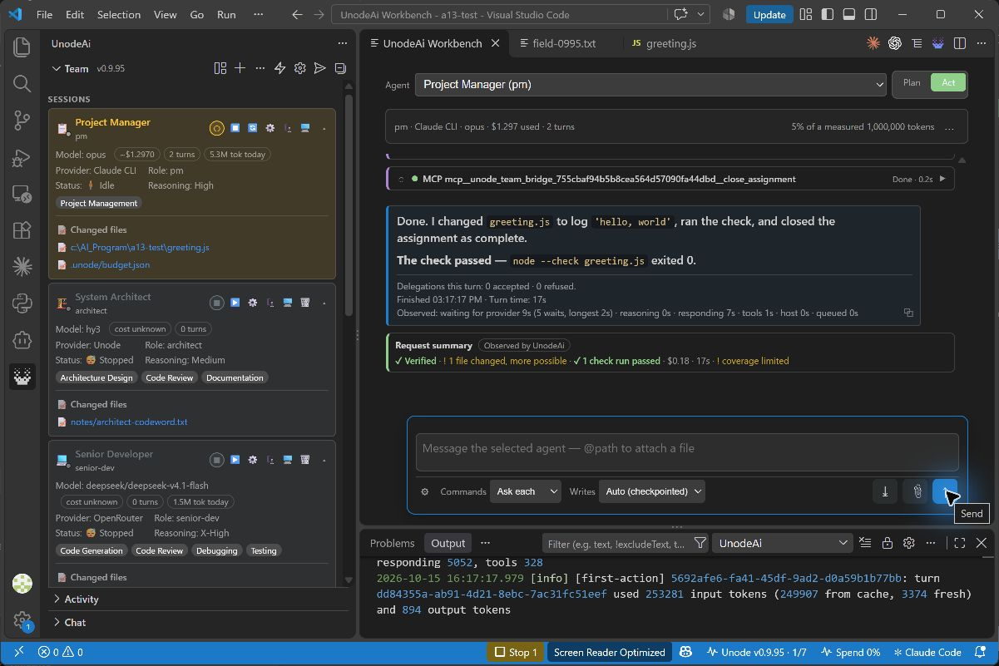

  

# UnodeAi

### Accountable AI teams, under your direction.

Give UnodeAi a job the way you would give it to a small team. A project manager agent splits it up, other agents
do the work, a reviewer checks it, and you get the finished files along with a record of what was actually run.

It covers a lot of everyday office work. Ask for a report from a spreadsheet and it reads the Excel or CSV file,
adds up the numbers by region or department, writes the Word or PDF report and builds the PowerPoint deck with
charts you can still edit. On Windows it can also render the pages, so you can see how they look before you send
them.

- Claude, Codex and other OpenAI-compatible models can work side by side on one team.
- One agent can review another's work, on a different model if you like.
- It reads contracts and reports, including Word files with tracked changes.
- It writes and fixes code too, and runs your tests.
- You approve what it wants to do and can stop it at any time.
- It runs in VS Code, Cursor and Devin on your own logins and API keys. No telemetry.

[Quick start](#quick-start) · [User guide](USAGE.md) · [Security model](SECURITY.md) ·
[Changelog](CHANGELOG.md) · [Models and pricing](https://www.unodetech.xyz/pricing?lang=en)

## Things you can ask for

- "Use `sales.xlsx` to write a Word summary of the regional totals, plus a PowerPoint slide with a chart."
- "Total `budget.xlsx` by department and put the table in a one-page memo."
- "Read these three reports and make a five-slide summary deck."
- "Go through `agreement.docx` and list every payment term, with the clause it comes from."
- "The login test is failing. Fix it, run `npm test` and show me what you changed."
- "Review the changes on this branch and tell me what's wrong, file by file."
- "Make a short deck from these notes, render it and check the layout." (Rendering needs Windows with PowerPoint
  or LibreOffice, and a model that can see images.)
- "Write the release notes, have the reviewer check them, then fix whatever it finds."

These are example requests, not case studies. How well a task goes still depends on the model you pick and how you
ask.

*When an agent hands control back to you, UnodeAi adds a card of its own. It is written from what UnodeAi saw
happen, not from what the agent said. In this one, UnodeAi ran the project's check itself and it passed, and the
card also notes what UnodeAi may have missed.*

## Why people use it

- The model that reviews the work doesn't have to be the one that did it. Each role can have its own model and
  connection.
- You see which files changed and which checks ran, as UnodeAi recorded them. An agent saying "done" is not taken
  as proof.
- Roles, rules and team setups are ordinary files in your project (`AGENTS.md`, `CLAUDE.md`, `.unode/rules.md`,
  `.unode/team.json`), so you can read them, review them and keep them in git.
- It runs in the editor you already use, on your own logins and keys. Tested on Windows; not yet tested on macOS.

## Office work

- **Excel and CSV.** It reads XLSX and CSV files, including formulas and their saved results. It does not calculate
  formulas itself; on request, installed Excel (Windows) or LibreOffice recalculates a copy. When you ask it to
  filter, group or total data, UnodeAi does the arithmetic itself, and tables built that way show the computed
  numbers rather than numbers the model typed in. Anything the model writes in its own words is still the model's
  text.
- **Word and PDF.** It writes DOCX and PDF documents, including tables built from your workbook data. PDFs use the
  Windows system fonts in this version. Its edits to an existing Word file are tracked changes by default, and it
  can work on the pages and forms of existing PDFs.
- **PowerPoint.** It builds decks with editable text, tables and native charts from workbook data, and it can make
  supported edits to existing Word and PowerPoint files. If a file has something it can't handle, it tells you
  instead of quietly changing it.
- You don't need Office installed to create documents, and it works even with commands turned off.
- **Seeing the pages.** On Windows with Word, PowerPoint or LibreOffice installed, it can render a copy of the file
  to page images. A model can only look at those pages if its connection accepts images.
- **Pictures.** If you pick an OpenAI API-key connection for image generation (it's off by default), agents can
  generate images, preview and save them, and put them in a presentation.
- It writes values, number formats and formulas into Excel workbooks, and saves formulas without calculating them.
  Some optional helpers in the bundled Word and PowerPoint skills need Python; the built-in Office tools don't.

More on formats, requirements and limits: [Office documents, spreadsheets and presentations](USAGE.md#office-documents-spreadsheets-and-presentations).

## Coding

- Agents read and edit your code and run your project's own commands, such as tests and builds, under the command
  setting you choose. File changes made through UnodeAi get restore points when it can keep a copy. If it can't,
  the change still goes ahead and UnodeAi tells you what it can restore, if anything.
- After each reply, a **Request summary** shows which files changed, which checks ran and whether they passed, and
  what it cost when the provider reports usage.
- In the optional worktree mode each agent gets its own git worktree. If you set up and approve a verify command,
  its result can decide whether work is merged into the integration branch. `unode.worktree.autoMerge` is off by
  default.
- Solo takes small, focused tasks itself. For bigger ones, a project manager splits the work among specialists.

## Working as a team

- You start with a three-person team: a project manager, a Generalist who does the work and an independent
  Reviewer, plus Solo for small tasks. There are 54 role templates and 27 team presets for software, marketing,
  sales, contracts and compliance, purchasing and more ([teams](USAGE.md#3-create-save-or-load-a-team)).
- The project manager plans, hands out the work and collects the results. Teammates can message it while they work.
- The reviewer's findings are numbered and kept. The project manager decides what to do about each one, and a
  finding is only closed after an independent reviewer has checked the fixed version of the same file. If nobody
  reviewed a piece of work, the record says so.
- The **Job outcome** card lists what changed, each review finding and where it stands, and what is left to do.
- You can export a run as a Markdown evidence pack, or as portable JSON that leaves out the text and file contents
  ([run evidence packs](USAGE.md#run-evidence-packs)).

## How you know what happened

- **What an agent says and what UnodeAi saw are kept apart.** A teammate's task card starts with a verdict based on
  what was recorded, such as **Task checks passed**, **Replied, not verified** or **No evidence**, not the agent's
  own "done". If the project manager decides otherwise later, the change shows on the card; the original isn't
  rewritten.
- **A passed check only means that check ran and passed.** It doesn't mean the content is right. Someone still has
  to read a document even after it was saved and rendered. Structure, data, rendered pages and visual review are
  reported as separate checks.
- **Reviews are independent.** Whoever made a fix can't close the finding about it.
- **You set the permissions.** The **Autonomy** menu in the chat box sets each agent to **Approve for me** (the
  default), **Ask for approval** or **Full access**. Commands, file writes, folder access, MCP access and Workspace
  Trust are separate controls, and they are enforced by the software, not just written into a prompt. Codex agents
  run under their own Codex profile (below). Commands you allow run with your user account's permissions and are
  not limited to the project folder. Whatever an agent reads is sent to its model provider, and UnodeAi does
  not strip credentials out of it. See [Autonomy](USAGE.md#autonomy) and
  [File access grants](USAGE.md#file-access-grants).
- **Security.** There is no telemetry, analytics or remote control. On startup UnodeAi contacts no host you
  haven't approved; that is based on a review of the source code, and we have no network capture to show it. Keys
  are stored in VS Code SecretStorage. Agents that can read are allowed to fetch public web pages at known
  addresses; each fetch shows up as a card, and setting `unode.webAccess` to `ask` or `off` makes it ask first or
  turns it off. In a workspace you haven't trusted, nothing gets executed. [SECURITY.md](SECURITY.md) is re-checked
  for every release. CI builds the release package and records its SHA-256, and those exact bytes are published
  without being rebuilt.

### Claude, Codex and compatible models

Claude CLI and Codex CLI run through your own logins. The Unode gateway, OpenRouter and other OpenAI-compatible
endpoints, your own local gateways included, use your own API keys. Claude and Codex agents can both lead a
team. Each connection keeps its own permission model; details are in [Provider settings](USAGE.md#provider-settings).

Choosing a Codex agent and its program is your consent for the Codex App Server to start. Each Codex agent runs
under a Codex permission profile that you choose:

- **Ask for approval**: Codex's `workspace-write` sandbox with `on-request` approvals.
- **Approve for me** (the default): `workspace-write`. Codex's first request in a turn to run a command outside the
  sandbox is usually sent back to try inside its sandbox; when Codex asks again, a command already failed there, or
  the command is destructive, outward or needs network, it is your card.
- **Full access (unsafe)**: no sandbox, network on, no prompts. It is always confirmed first and flagged with a
  persistent warning, and it bypasses UnodeAi's host command, delete, outward-action and checkpoint checks.

Under Ask for approval, routine commands and edits inside the workspace sandbox run without a card. Routine Codex
edits do not create UnodeAi checkpoints. Plan mode, an untrusted workspace, no writable folder grant or a tool limit
without write access puts Codex in **Read only**. Writable folder and task limits instead keep Codex's workspace-write
sandbox to those folders. MCP tool calls that Codex routes for approval get a UnodeAi card.

Codex connects to OpenAI and to the model provider configured in your Codex. UnodeAi does not control those
network destinations. It also does not claim that Codex reads are confined to the workspace.

## Quick start

1. **Install** UnodeAi from Open VSX (Cursor's marketplace mirrors it) and open your project folder. After a fresh
   install the Workbench, the UnodeAi tab in the editor area, opens once. Otherwise run **UnodeAi: Get Started**,
   or click **Start your first task** in the empty Team panel.
2. **Type your goal** under **What do you want to get done?** and press **Send**. Send does not start the task yet.
3. **Set up any missing connection.** UnodeAi checks the connection without a model request. If something is
   missing, one card says what: **Set the API key**, **Choose the Claude CLI…** or **Choose the Codex CLI…**,
   **Open a terminal** to sign in (the login command is typed in, not run) and then **Check again**, or **Choose a
   model** for a custom gateway. **Use a different connection** changes this task's connection only.
4. **Choose Solo or a team.** **Start this task with the three-person team** (recommended; it can take several
   model calls) or **Start this task with Solo**. **Custom team…** opens the full team picker. The button you press
   creates the agents and sends your goal.
5. **Review the results.** Read the Request summary and, for team work, the Job outcome with its Review section.
   **Review changes** opens the recorded changes; open delivered documents to check them yourself.

To go through connections, team, permissions, folders, skills and MCP first, run **UnodeAi: Setup Guide**. It
never sends a task. The [User guide](USAGE.md#2-first-time-setup) covers each step.

## New in v0.9.110

- **Task history.** Find a past task again: search goals and results, and filter by member, state, verification, dates
  and favourites. **Resume…** puts a task's goal back in the message box. You can delete a task's conversation, its
  restore points or both, or everything at once in **Manage storage**.
- **Revert to before a request.** Put back every file that one member's request, and that member's later requests,
  changed. A preview lists each file first, and a file that changed since is left as it is. **Undo revert** and **Redo
  revert** work file by file. A revert runs nothing again and does not touch Git.
- **Exact restore of Claude and Codex edits.** When a Claude or Codex member's own file change passes through UnodeAi
  first, UnodeAi keeps the file's exact bytes, so a restore brings even a binary file back byte for byte.
- **Reply suggestions, if you turn them on.** After an answer, a model you choose can suggest one reply. **Tab** puts it
  in the message box, and nothing is sent until you press **Send**. Each suggestion is one billed request. It is off
  by default.
- **Code navigation.** `go_to_definition` and `find_references` ask the editor's language service where a symbol is
  declared and used. They name only locations the member may read.

Validated on Windows 11 with the installed build: Revert to before a request, Undo and Redo revert (including a
binary file, and after a reload), exact restore of a Claude Edit and a Codex file change, Task history search,
favourite, Resume and every deletion, a reply suggestion accepted with Tab, and `go_to_definition` / `find_references`
across two TypeScript files, with Unode `gpt-4.1-mini`, Claude CLI and Codex members. Not verified on macOS.

## Previously in v0.9.109

- **Public web search with sources.** Agents can search the web through Unode and cite what they found, by title and
  link. Because searching costs money, each search asks first when **Network access** is **Ask**, and shows the price.
  You can turn search off for one member in Agent Builder.
- **Images and recordings through a gateway.** Each member can use the default image and transcription models, a
  specific one, or none. Unode `gpt-image-2` makes 1024×1024 images with a receipt, and Codex members use the same
  governed image tool.
- **Complete, exactly saved transcripts.** WAV or MP3 recordings up to 25 minutes are transcribed in parts, so long
  recordings are complete. UnodeAi saves the transcript itself, next to the recording, exactly as the service
  returned it. If a part fails, the result says which minutes are missing.
- **Integrations you can manage.** In **Marketplace → Integrations** you can edit, test, grant or remove an
  integration, and choose which members may use it.

Validated on Windows 11 with the installed build: web search, gateway images, a Codex member's image, an integration
grant and revoke, and a 19-minute recording transcribed and saved by a Unode `gpt-4.1-mini` member. Not verified on
macOS.

## Previously in v0.9.108

- **Word changes you can review.** Agents read the tracked changes and comments in a Word file, including who made
  them. Their own edits to an existing file are saved as tracked changes under a name you can set, so you accept or
  reject them in Word. They can also add comments, reply to them and mark them resolved.
- **Workbooks that stay live.** Agents write values, number formats and formulas into new or existing Excel
  workbooks. If you say a total is the sum of three columns, they write the formula. UnodeAi saves formulas without
  calculating them and says so. When you ask, installed Excel or LibreOffice recalculates a private copy and reports
  the values it produced.
- **PDF work.** Agents can merge, split, reorder, rotate and number pages, add a watermark, fill in forms, and add
  notes and highlights, without Office installed. On Windows, agents can also export a Word or PowerPoint file to
  PDF and turn PDF pages into images for a model that can see them. To change the text of a PDF, they edit the
  source document and export it again, or, if you have turned off Word's PDF notice, have Word convert the PDF to an
  editable document first.
- **Open, Reveal and Export PDF.** Files in a result card and file links in a reply open with their default app or
  show in their folder. On Windows a Word or PowerPoint file also has Export PDF, which you can use while the agent
  keeps working.
- **Your signature, only when you say so.** Save a signature image in Settings and agents can place it on a PDF.
  Every placement asks you first, and the saved image is not sent to a model. A signed PDF is a file like any other,
  which an agent can read. It is a visible signature, not a digital certificate.
- **Stopping a render.** Stop ends a Word, PowerPoint or LibreOffice render at once. UnodeAi never force-closes Word
  or PowerPoint: its helper closes only its own copy. LibreOffice conversions now stop after five minutes. Known
  limit: if VS Code closes, reloads or crashes during a render, a Word or PowerPoint instance UnodeAi started can stay
  running in the background ([details](USAGE.md#office-documents-spreadsheets-and-presentations)).
- **Costs that say what they are.** A stopped turn, a subscription turn and a turn whose usage was never reported
  each say so, instead of showing $0 or nothing.

Validated on Windows 11 with the installed build and Office 16.0.20625: Word, Excel and PDF work by Claude CLI, Codex
CLI and Unode `gpt-4.1-mini` members, a signature placement, and Stop during a Word render. Not verified on macOS.

## License

See [LICENSE](LICENSE).
