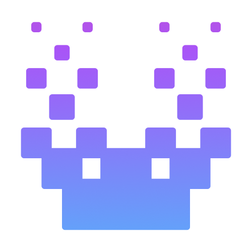
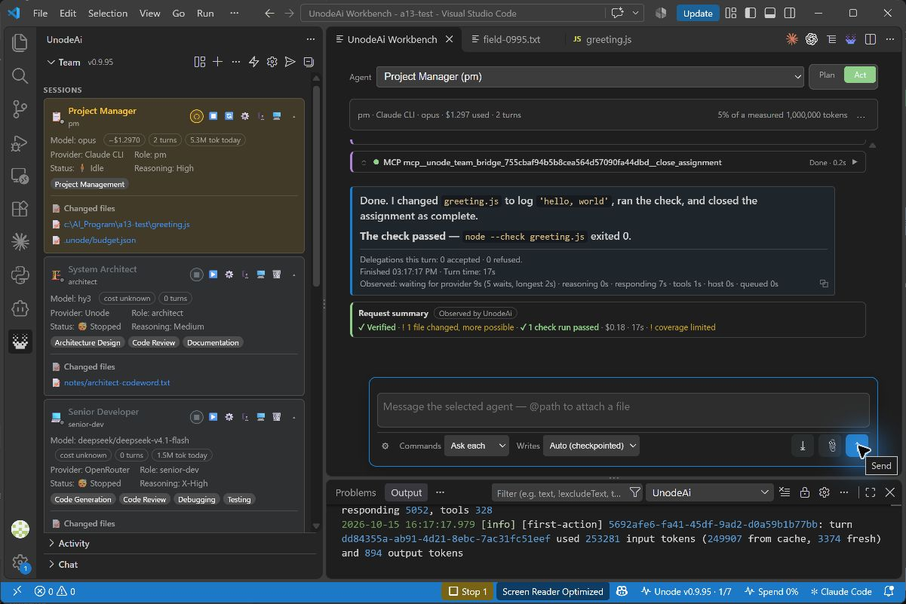

  

# UnodeAi

### Accountable AI teams, under your direction.

**From vibe coding to vibe engineering.**

Vibe coding: you ask, the AI says “done”, and you hope. Vibe engineering: every agent has a role, enforced
limits, and a record you can check.

UnodeAi organizes AI agents into a team for engineering, design, marketing, sales, compliance, finance,
operations and more. A project manager agent delegates the work. You can follow every task, approve or refuse
what an agent asks to do, and stop it. You can also export the record from request to result.

An agent saying “done” is never evidence. UnodeAi keeps what an agent claims apart from what UnodeAi saw
happen. It records whether an objective check ran and passed. Where judgment is needed, a person can record the
verdict. You can put different models and providers on one team and have one review another's work, under
roles and permissions you set.

Delegate with confidence: your direction, a record you can audit, and no result called verified until it has
passed a check.

UnodeAi runs in VS Code, Cursor and Devin with your own providers and keys. It sends no telemetry and makes no
network call at activation. The SHA-256 of the exact bytes you install is published.

- **No black box.** You decide which folders, commands and network destinations your agents may use. This is
  enforced in software, not requested in a prompt. The [security model](SECURITY.md) says where the boundary
  ends. UnodeAi records every tool call and file change that goes through it. It also tells you when something
  happened outside its view.
- **Your process, not ours.** Describe your own roles, rules and workflows once. They are saved as files in
  your project, where you can read, review and version them.
- **Your models, your accounts.** UnodeAi runs Claude and Codex through your own CLI logins, and any
  OpenAI-compatible model through your own key. Requests go to the providers you choose. UnodeAi sends no
  telemetry.

*After every reply that hands control back to you, UnodeAi adds its own card, written from what it recorded and
not from what the agent said. This one: UnodeAi ran the project's check itself, and it passed. The card also
flags what UnodeAi may have missed.*

[Get started](#quick-start) · [User guide](USAGE.md) · [Security model](SECURITY.md) ·
[Changelog](CHANGELOG.md) · [Models and pricing](https://www.unodetech.xyz/pricing?lang=en)

<!-- Add the Mission Control screenshot here when a real product asset is available. -->

## Built for the work where “it says it’s done” is not enough

| If you… | UnodeAi gives you |
| --- | --- |
| **Bill for the work** — agency, consultancy, contractor | A run exported as one Markdown file that the client can read without installing anything. It lists every dispatch, decision, approval and scope grant — and what it left out. A portable JSON variant carries no request text, instructions, command lines or file contents. Agents and approvers become document-local numbers, and private routes become bounded categories. Write-time hashes prove change equality without keeping the source. The variant declares both what it withheld and what it kept. |
| **Answer to someone** — regulated, procurement-reviewed, or security-reviewed teams | Evidence recorded as the work happened, not reconstructed afterwards. Contract, privacy and GRC roles with read-only capabilities. A sanctions/export-control skill whose correct output is a refusal routed to a named person. |
| **Run more than one agent** | A coordinator that reports `partial` or `blocked`, with a reason for each undelivered item, instead of going quiet. If it ends without saying anything, UnodeAi itself writes a closing summary from observed facts. That summary claims nothing about correctness. |
| **Refuse to hand your code to one vendor** | Per-agent routing across Claude, OpenAI Codex, OpenAI-compatible endpoints and your own gateways. Keys live in the OS keychain. Nothing leaves the machine unless you ask for it — no telemetry, no control service, no request at activation. |

## From vibe coding to vibe engineering

AI coding is no longer limited to traditional software teams. Application engineers, technical salespeople,
and business leads can now build internal tools and respond to customers without waiting for a central backlog.
That speed is valuable. The risk is that every project invents its own structure: different agents, different
permissions, missing reviews, undocumented deployment steps, and no reliable record of what actually happened.

UnodeAi lets a company keep that speed and still put the engineering system back around the work. Claude,
Codex, and compatible models can work as one team that you can inspect. The project owns its roles, rules,
workflows, approvals, checks, and deployment expectations. They travel with the repository instead of living
in one person's chat history. The permission layer controls what each role may do. The evidence layer records
what changed, what was checked, and what still needs a person.

The goal is not to turn every builder into a traditional software engineer. It is to let more people build
without making the resulting software unmanageable.

## Companies already solved this. We’re teaching it to agents.

A company is not just a group of capable people. It’s a set of agreements: who owns what, who decides, who
reviews, and what gets written down. Those agreements are why a hundred people’s work adds up instead of
colliding.

Nobody designed them in a room. They were worked out over a century of getting it wrong. They remain the most
tested coordination technology we have.

Agents skipped all of it.

The last three years went into making a single agent more capable. Almost none of it went into how several
agents work together. So a team of agents ends up looking like a company with no job titles, no manager, no
sign-off, and no filing cabinet. Everyone is competent. Nothing is accountable.

If you have given an AI real work, you already know how this feels. It sounds just as confident when it fails
as when it succeeds. Nobody reviews it but you. And when it’s finished, you have a chat log where a record
should be.

A better model doesn’t fix that. Ask a stronger one the same way and it fails the same way, because what was
missing was never intelligence.

**UnodeAi supplies the structure.** Each agent has a role and a mandate. A project manager agent assigns the
work and collects the results. Permissions decide what each one can reach. Finishing means something specific:
a check that ran, or a person who signed off. And the record keeps what an agent claimed apart from what
actually happened, because “I’m done” has never counted as proof in a company either.

This stopped being optional when agent output started leaving the building — into client deliverables, audits
and procurement reviews. There, a chat log is not an artifact anyone can accept.

We’ll say what we’re betting on. This structure is proven for people. Whether it works as well for agents is
the question this product exists to answer. The evidence layer is there so you can judge for yourself.

## What the organization is made of

UnodeAi ships **52 role templates** and **25 team presets**: Software Engineering, Marketing, Sales, Contract
& Compliance, Security & Governance, Business Operations, Revenue Operations, Customer Experience, Data
Intelligence, Product Discovery, and more. With them, a team is something you assemble, not something you
rebuild in every conversation.

| | The company equivalent |
|---|---|
| **Role** | a job title with a mandate |
| **Skills** | the procedures that job runs on, loaded when they are relevant |
| **Manager** | a project manager agent that assigns work and collects results |
| **Workflow** | a repeatable handoff between roles |
| **Authority** | what this position may reach, and what needs approval first |
| **Evidence** | the file that outlives the conversation |

No single model is best at everything any more, so *which model runs which role* is a decision worth making
per agent rather than per vendor.

## Why us

**The evidence layer is the product, not a feature attached to one.** It is cheap to add a summary view to a
tool that already trusts its agents. But such a view does not survive contact with a run that went wrong. Here
the separation is structural. Verdicts come from recorded writes and observed check results. A delegate's
prose cannot become a green verdict. The rules are held in place by mutation tests that fail if a sensor stops
sensing.

**Our own claims are auditable too, which is the only reason to believe the rest.** `SECURITY.md` is
re-audited before every release, and it records what it got wrong. That includes a boundary that the previous
release overstated. That statement was corrected in place, not quietly rewritten. CI builds the shipped
artifact. A person publishes those exact bytes without rebuilding them. The SHA-256 is published, so you can
check what you installed against what was reviewed.

**It runs where you already work.** VS Code, Cursor and Devin — with your providers, your keys and your
team.

## Quality is a mechanism, not a promise

UnodeAi separates what an agent says from what the framework actually observed.

| What happened | What UnodeAi can honestly say |
|---|---|
| A delegation returned without a framework-visible trace | **No evidence** |
| Read, search, or other tool activity was recorded, but no change was verified | **Tool activity recorded; delivery not checked** |
| Files changed, but no matching passing verification was observed | **Replied, not verified** |
| A recorded change has an observed passing verification result | **Verified** |
| The coordinator explicitly decided to rely on the result | **Coordinator accepted** |
| The coordinator rejected an earlier result | **Coordinator rejected — amended**, with the earlier verdict and reason still visible |
| A decision belongs with a person | **Human intervention required** |

A green framework verdict means a check actually ran and passed. It never means a model declared its own work
good. Likewise, coordinator acceptance is an agent coordinator's explicit decision — not customer,
enterprise, or human acceptance.

The latest mechanism closes a gap that our own field run exposed. A coordinator rejected work after an earlier
verdict had already been shown, but the framework never captured that decision. The coordinator can now record
`accepted`, `rejected`, or `needs-human` after it actually decides. A rejection requires a reason. The reason
is forwarded to the delegate, and the verdict is visibly amended in Chat, Messages, and the Team card. UnodeAi
captures a decision the coordinator already made. It does not add an LLM judge.

## How work moves

1. **You state the outcome.** Use Solo for a focused task, or give the Project Manager a substantial goal.
2. **The PM plans and delegates.** It assigns roles, declares task scope, tracks progress, and keeps parallel
   work from silently colliding.
3. **Specialists work inside your boundaries.** Rules guide them. Configured tools, approvals, provider
   routes, and folder access define their actual authority.
4. **Optional isolation keeps parallel changes reviewable.** When you enable worktree mode, delegated work
   can run in isolated lanes. UnodeAi does not infer or enable worktree mode from the wording of a task.
5. **Your real check can gate integration.** When worktree mode is enabled and a verify command is configured
   and approved, the command's observed result can gate the merge. If any of these conditions is missing,
   UnodeAi does not claim an automatic quality gate.
6. **You review the integration.** `autoMerge` is off by default. The integration branch and its evidence
   remain available for review before work lands.
7. **You get the record.** See what changed, which tools ran, what passed, what was not checked, and whether a
   later coordinator decision amended an earlier verdict.

## Your process, as files you can inspect

The working agreement belongs with the project:

| What you define | Where it lives | What it does |
|---|---|---|
| **Repository guidance** | `AGENTS.md`, `CLAUDE.md`, `.unode/rules.md` | Records conventions, constraints, review expectations, and project-specific instructions |
| **Team** | `.unode/team.json` | Defines members, roles, registered model routes, instructions, workflows, and restrictions that can only narrow host authority |
| **Workflows** | The team definition | Encodes repeatable role-to-role work, so the sequence is not rebuilt in every chat |

Repository guidance has a documented order of precedence that you can inspect: `AGENTS.md`, then `CLAUDE.md`,
then `.unode/rules.md`. That does not magically make one file impossible to override. It makes the order
visible and reviewable, and you can change it through the files you control.

Project knowledge is progressively disclosed. Each turn receives compact, deterministic indexes of the
instruction files and of the structured Markdown under `docs/`. An agent can load a relevant source in full
through the existing root-confined read tool. This reduces standing context, but we do not claim that
every task becomes cheaper. An agent may spend additional turns or tool calls fetching what it needs.

Rules can direct behavior, but they cannot grant authority. Project files do not widen Workspace Trust,
command approval, network consent, MCP grants, write policy, or folder access. The host still enforces those
boundaries, and you can inspect each of them separately.

## Why teams choose UnodeAi

| Advantage | What it means in practice |
|---|---|
| **An AI team that follows your process** | Roles inherit your project rules, handoffs, workflows, and checks. Your team does not have to adopt a proprietary ritual |
| **Evidence that names its limits** | Status comes from actions and checks that the framework can see. Later coordinator decisions amend the record rather than rewrite history |
| **Control at the task level** | A delegation can narrow a teammate's folder access for one assignment without permanently changing the agent |
| **A model per role** | Use premium reasoning where it matters, economical models for routine work, and different providers in the same crew |
| **Optional isolated delivery** | Worktrees that you enable keep parallel changes separate. Checks that are configured and approved can gate integration |
| **Inspectable context and cost** | The context manifest lists sources and estimated text tokens. Actual cost appears only where the provider's usage data supports it |
| **Security controls in the product** | Workspace Trust, per-host egress consent, command/write approval, MCP grants, folder scopes, and credential state are visible controls |

Model choice matters, but it is not the durable moat. Providers change, prices fall, and stronger models
arrive. What lasts is the process, the evidence, and the authority boundary. Your team can keep them while it
swaps the model underneath.

## Built with the team it ships

UnodeAi is built and audited with UnodeAi. For each release, we ask the shipped product to investigate the
previous release. Then we turn the field evidence into the next mechanical guard.

That practice has changed the product in concrete ways:

- A field run found a read-only result described too generously. The verdict was narrowed to **Tool activity
  recorded; delivery not checked**.
- In another case, a coordinator decision arrived after the verdict had been displayed. Since v0.9.47, the later
  rejection is visible, and the reason the verdict changed is preserved.
- Our own audits found places where a technically correct mechanism was still invisible at the decision point.
  That is why export truncation, temporary task scope, and overlapping delegation are now shown.

This is not a claim that the product validates itself. It is a receipt for how defects are found. Unit tests,
mutation gates, deterministic harness tasks, field runs, and human review each answer a different question.
None of them is credited with evidence it did not collect.

## Security without surrendering usefulness

- **No telemetry.** UnodeAi runs no analytics service and no control service that can be reached remotely.
- **Destinations are explicit.** Model data goes to the providers you configure. Tools that can reach the network
  use destinations you configured or explicitly approved. UnodeAi makes no absolute claim that workspace data
  never leaves the machine while you are using a model or an approved tool.
- **Workspace Trust is honored.** Execution surfaces stay off in an untrusted workspace.
- **Effects are gated.** Commands and writes follow the policy you set. MCP integrations that UnodeAi manages
  are denied by default for each agent until they are granted. MCP servers you configure directly in Claude or
  Codex stay under that CLI's own controls.
- **File tools are rooted.** Real-path checks prevent traversal and symlink escapes. Task scope can narrow
  access, but it cannot widen the agent's permanent grant.
- **Secrets use VS Code SecretStorage.** Keys do not belong in team definitions, settings, exports, logs, or
  source control.
- **Human control remains human.** `needs-human` records that a decision is required. Coordinator acceptance
  is never presented as enterprise sign-off.

See [SECURITY.md](SECURITY.md) for the complete network, execution, storage, Workspace Trust, and packaging
model.

## Quick start

1. Install UnodeAi and open a trusted workspace.
2. Choose a provider: use the Unode gateway, connect an OpenAI-compatible endpoint, use a local gateway, or
   run Claude or Codex through your existing CLI login.
3. Create or import a team, then choose which model, capabilities, folder access, and MCP grants belong to
   each role.
4. Keep the project guidance you already use in `AGENTS.md` or `CLAUDE.md`, and add
   `.unode/rules.md` when you want UnodeAi-specific team guidance.
5. Optionally enable worktree mode. If you want verified merge gating, configure and approve the verify
   command and keep `autoMerge` off until you deliberately choose otherwise.
6. Give Solo a focused task, or give the PM a larger outcome. Review the transcript, evidence, changes, and
   integration branch before you finalize.

The [User guide](USAGE.md) covers provider setup, teams, approvals, worktrees, workflows, MCP, exports, and
troubleshooting.

## A growing ecosystem, with bring-your-own paths

The catalog keeps growing across models, roles, skills, and MCP integrations. Growth is not limited to what
ships in one release:

- Start from built-in software, product, research, writing, operations, marketing, sales, finance, and
  governance roles. Then edit them or define your own.
- Attach skill playbooks that are progressively disclosed when they are relevant, instead of putting every
  procedure in every prompt.
- Connect supported MCP integrations per agent, with explicit grants.
- Bring your own OpenAI-compatible endpoint, gateway, model, API key, role instructions, workflows, and MCP
  servers. Choose from the growing set of validated skill playbooks.

The point of the ecosystem is choice under one governance model. A larger catalog should not become a reason
to hide what an agent can access or where data can go.

## Providers and capabilities

Use the Unode gateway for one account across many models, or connect another OpenAI-compatible provider. You
can also route to a local or self-hosted model, or use Claude or Codex through your own CLI login. Claude and
Codex agents can both lead a team. Both can use UnodeAi playbooks and granted integrations, each under its own
permission model.

UnodeAi asks for your consent before the Codex App Server starts. Each Codex agent runs under a Codex
permission profile that you choose:

- **Ask for approval** (the default): Codex's `workspace-write` sandbox with `on-request` approvals.
- **Approve for me**: Codex's reviewer decides. UnodeAi shows the review trail through Codex's `auto_review`
  mode.
- **Full access (unsafe)**: no sandbox, network on, no prompts. It is always confirmed first and flagged with
  a persistent warning.

Routine Codex edits do not create UnodeAi checkpoints. Under Ask for approval, routine commands and edits
inside the workspace sandbox run without a card. Plan mode and host trust, folder and tool ceilings resolve to
**Read only**.

Codex connects to OpenAI and to the model provider configured in your Codex. UnodeAi does not control those
network destinations. It also does not claim that Codex reads are confined to the workspace. Repository CLI
configuration loads only after a content-bound confirmation. The [User guide](USAGE.md) has the full details.

Roles can use different providers in the same crew. The surrounding process — context, permissions, approvals,
task scope, evidence, and verification — remains inspectable when you change the model.

Core capabilities include:

- PM-led delegation with async fan-out, progress, result collection, and file-scope conflict detection
- Long tasks that hit a safety stop return a clear partial answer that the coordinator can continue
- Custom agents, reusable role templates, progressively disclosed skills, and deterministic workflows
- Explicit task-scoped folder access that can narrow but never widen a delegate's permanent grant
- User-enabled git worktrees, reviewable integration branches, and optional verify-command merge gating
- `autoMerge` off by default
- Coordinator `accepted`, `rejected`, and `needs-human` decisions with visible amended verdicts
- Evidence views in Chat, Team, and Messages, plus exports that disclose when they were truncated to the
  retained window
- Per-turn context manifests with source provenance and estimated text-token counts
- Actual usage and cost, shown only when the selected provider reports enough usage data to support them. Each
  cost is labelled by its source. Optional spend reminders never stop work
- Provider-accurate command/write controls (UnodeAi's gates for hosted tools and Claude, and Codex's own
  permission profile for Codex), rooted file tools, Workspace Trust, per-host egress consent, and default-deny
  managed MCP grants
- **Your integrations**: each integration's connection and granted agents in one place, with remove-and-revoke
- Custom and bring-your-own options across providers, models, roles, workflows, and integrations, alongside a
  growing catalog of validated skill playbooks

## New in v0.9.97

**File changes that go through UnodeAi are checked first, and reported as UnodeAi saw them.**

- **A restore puts back the file the agent changed.** Before UnodeAi's own file tools replace or delete a file,
  they keep its exact bytes, and restoring that change puts them back byte for byte. A restore acts on the file the
  change was recorded for, and it is refused over unsaved editor changes or over newer work. Restore points are
  kept within limits: 32 MiB a copy, 256 MiB a workspace, 30 days.
- **Work that is not the agent's needs your decision.** Before a change by UnodeAi's file tools, Claude's own
  edits or a Codex file change that Codex asks UnodeAi to approve, a file with unsaved editor changes is refused,
  and a file that may hold work that is not the agent's asks you first, for that one change. Edits Codex's own
  sandbox allows, every edit under Full access, and files a shell command writes are not checked.
- **An agent can save a file you attached.** `save_attachment` writes the exact bytes of a PNG, JPEG, PDF or text
  file you attached, through the same checks as any write, and reports the SHA-256 read back from the disk.
- **The Request summary lists the files a request changed, as UnodeAi observed them**, teammates' changes included,
  and marks a change that may or may not have happened as uncertain. A reply that says a file was saved counts
  nothing.
- **Codex agents receive the text files and images you attach.** A text file goes into the turn. An image goes as
  an image when the thread's model accepts images; otherwise the turn is refused before anything is sent.
- **A link to a workspace file in a reply opens it**, at the line it names, after UnodeAi checks that the agent may
  read the file.

**Long tasks end the way they really ended.**

- **Stopped means seen to stop.** After Stop, the Team panel shows **Stopping** until UnodeAi sees the agent's
  processes end, and **Stop unconfirmed** when it cannot. UnodeAi then starts no second process of that agent by
  itself.
- **A timeout ends the wait, not the task.** A later result is still recorded, and `cancel_task` with a handle stops
  only that task.
- **A long deliverable can arrive section by section.** Each batch is written to disk before it is confirmed, so it
  survives a timeout or a Stop.

**The CLI that runs is the CLI that was checked.**

- **Every start checks the program's files.** A program UnodeAi has not tested asks once, before anything of it
  runs, and agents then use exactly those files.
- **Managed Codex (Windows x64), optional.** UnodeAi downloads supported Codex versions into its own folder, checks
  every file against the hashes and publisher signatures its list names, and runs a new version only after your OK. Your
  own Codex installation is not changed.
- **Checked with Codex CLI 0.163.0 (OpenAI's Windows x64 package, as managed Codex uses it) and Claude CLI 2.1.306
  on Windows x64.** Their exact files start without the question; any other version or installation asks once.

Four path-safety defects, a file-restore defect and a Stop defect of 0.9.96 are corrected; see `SECURITY.md`.

## Previously in v0.9.96

**One shell per command, from the approval to the run.** A command now runs in the shell that was checked and
approved, in a folder UnodeAi checked, and UnodeAi reports a stop only when it saw one.

- **The approval card names the shell.** On an OpenAI-compatible agent, a foreground command runs in the agent's
  own terminal, under your default terminal profile. The card names its shell, for example `Shell: Windows
  PowerShell`, and the command runs in that shell and no other. In a PowerShell terminal, a PowerShell cmdlet now
  runs.
- **Nothing starts before you approve.** The terminal opens only after the approval. UnodeAi then proves its
  shell, its folder and that it can read the output. If the shell is not the one on the card, the command does not
  run, and the agent's retry is checked for the right one.
- **A fallback is named, never silent.** If the terminal cannot be used, the agent's next command runs in
  `cmd.exe` on Windows or `/bin/sh` on macOS and Linux, and its approval card names that shell. Syntax that cannot
  run in the shell, such as a cmdlet in `cmd.exe` or `&&` in Windows PowerShell 5.1, is refused with an equivalent
  before any card.
- **Commands do not run into each other.** One agent's foreground commands run one at a time; different agents
  run in parallel. A timed-out command is stopped together with the processes it started that UnodeAi can find,
  and its terminal is replaced. If UnodeAi cannot confirm the stop, that agent runs no more commands, in the
  background either, until you restart it.
- **Output keeps its end, and silence is a result.** The agent sees the start and the end of a long output. A
  command that prints nothing is judged by its exit code.
- **`kill_command` tells the truth.** A background command is reported killed only after UnodeAi saw it end.
- **Approvals belong to one kind of shell.** An approval given in PowerShell does not cover `cmd.exe`. **Enable
  safe commands** covers all three kinds. After the update, a command you approved for a project earlier may ask
  once more, and a safe list you enabled earlier must be enabled again.

**Which CLI runs, and a Workbench you can reopen after a restart.**

- **You can see and choose the CLI.** In Settings → Providers, the Claude CLI and Codex CLI cards show the program
  UnodeAi starts and, once checked, its version. **Check / choose CLI…** lists the installed programs without
  starting any of them. UnodeAi switches only to a program it has checked, after you confirm.
- **The update stays in your hands.** Once you allow `registry.npmjs.org`, Check / choose CLI also shows the latest
  version published on npm. **Update in terminal** types the update command in a new terminal, and it runs only
  when you press Enter.
- **A Workbench cut off by Restart Extension Host can be reopened.** UnodeAi offers to reopen it, with your unsent
  text from a saved local copy, and sends nothing. After Reload Window, the agent you last chose is selected
  again.
- **You see which model ran.** The chat's session line shows the model the CLI says it runs, next to the one you
  asked for.

## Previously in v0.9.95

**One meaning, from the permission to the card.** In some cases, UnodeAi said one thing where a permission
was granted, another where it was enforced, and a third on the card. This version fixes those cases.

- **A scope that names a file grants that file.** An entry in a task scope, or in an agent's Folder Access, may
  name one existing file. The agent can then read and change exactly that file, and nothing next to it.
  Previously, such an entry was accepted, but every write to it was refused. A scope with files and no writable
  folder has no command tool. This applies to OpenAI-compatible agents, whose file tools UnodeAi runs itself.
- **A restored conversation does not redo an old request.** Sometimes a request gets no answer because the
  window closed or the provider failed. After a restart, it is no longer resent to the model with your next
  one. You see one line, such as `Your earlier request was interrupted and was not resumed. Send it
  again if you still want it.` Only your new request runs. An OpenAI-compatible agent keeps what was answered
  before as context. A Codex CLI agent whose request was cut off starts a new Codex conversation.
- **A review of a file in your workspace can be closed.** A coordinator can mark a task as a review of one
  workspace file. UnodeAi notes the file when the review is dispatched. It accepts the reviewer's cited
  evidence only while the file is unchanged. If the file has changed since then, the attempt to close the
  review is refused, and the coordinator is told that no evidence was submitted.
- **The closing line and the Job outcome no longer disagree.** After a coordinator's turn, UnodeAi adds a line
  that says which decisions are still owed. It says nothing about checks or completion. Only the Job outcome
  reports those.
- **A replaced attempt is history, not a task.** A delegation card counts each task once. An attempt that the
  coordinator superseded, or that UnodeAi retried, stays in the card as `in history`. It owes no decision, and
  it no longer keeps an agent's row marked `Interrupted`.
- **Refused writes are not a finished task.** If UnodeAi refused every file change in an attempt, the attempt
  counts as blocked. The Job outcome lists it as unfinished, whatever its reply says.
- **Words that say only what was recorded.** A Job outcome says `Task checks passed` for the checks a task
  declared. `Verified` is reserved for the Request summary, when UnodeAi's own run of your verification
  command passed. A turn that changed something without a passing check now reads `Finished — not verified`
  instead of `Completed — not verified`. The card also says whether a verification command was configured at
  all.
- **Exit codes you can look up on Windows.** A failed command now shows the code that the program set, such as
  `-4058`. Previously, it showed `4294963238`.

## License

See [LICENSE](LICENSE).
