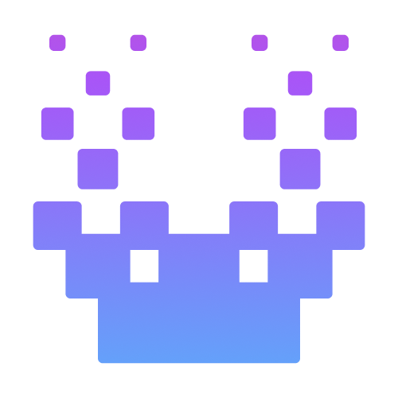

  

# UnodeAi

### Accountable AI teams, under your direction.

**From vibe coding to vibe engineering.**

Vibe coding: you ask, the AI says “done”, and you hope. Vibe engineering: every agent has a role, enforced
limits, and a record you can check.

UnodeAi organizes AI agents into a team for engineering, design, marketing, sales, compliance, finance,
operations and more. A project manager agent delegates the work. You can follow every task, approve or refuse
what an agent asks to do, and stop it. You can also export the record from request to result.

An agent saying “done” is never evidence. UnodeAi keeps what an agent claims apart from what UnodeAi saw
happen. It records whether an objective check ran and passed. Where judgment is needed, a person can record the
verdict. You can put different models and providers on one team and have one review another's work, under
roles and permissions you set.

Delegate with confidence: your direction, a record you can audit, and no result called verified until it has
passed a check.

UnodeAi runs in VS Code, Cursor and Devin with your own providers and keys. It sends no telemetry and makes no
network call at activation. The SHA-256 of the exact bytes you install is published.

- **No black box.** You decide which folders, commands and network destinations your agents may use. This is
  enforced in software, not requested in a prompt. The [security model](SECURITY.md) says where the boundary
  ends. UnodeAi records every tool call and file change that goes through it. It also tells you when something
  happened outside its view.
- **Your process, not ours.** Describe your own roles, rules and workflows once. They are saved as files in
  your project, where you can read, review and version them.
- **Your models, your accounts.** UnodeAi runs Claude and Codex through your own CLI logins, and any
  OpenAI-compatible model through your own key. Requests go to the providers you choose. UnodeAi sends no
  telemetry.

*After every reply that hands control back to you, UnodeAi adds its own card, written from what it recorded and
not from what the agent said. This one: UnodeAi ran the project's check itself, and it passed. The card also
flags what UnodeAi may have missed.*

[Get started](#quick-start) · [User guide](USAGE.md) · [Security model](SECURITY.md) ·
[Changelog](CHANGELOG.md) · [Models and pricing](https://www.unodetech.xyz/pricing?lang=en)

<!-- Add the Mission Control screenshot here when a real product asset is available. -->

## What UnodeAi can do on your computer

Agents can read files, edit code and documents, save attachments and run programs using the tools you enable.
The **Autonomy** menu in the chat input changes the selected agent. Point at a position, or move to it with the
keyboard, to read what it allows.

| Choice | What it permits |
| --- | --- |
| **Approve for me** | File tools use the workspace and configured access scope. You can grant an exact outside file or folder **Read** or **Read + Write**, for a request or session. |
| **Ask for approval** | Requests review for mediated writes and commands. Remembered decisions and independently chosen restrictions still apply. Native Codex review works differently, as explained below. |
| **Full access** | After an explicit enable confirmation, host file tools and Claude's mediated writes can reach outside the project as your OS account permits. |

Off, Ask, Plan, Folder Access, tool and task restrictions remain effective; the selected position's description in
the menu lists them. Plan permits already-authorized reads and prevents
changes. Enabling Full access starts no task, scan, model request, download or program launch.

File-tool scope is not a sandbox for commands. Allowed host and Claude commands run with your OS account's
permissions and can affect files outside their working folder. Native Codex CLI uses its own sandbox and reviewer:
Ask concerns escalation, not every edit. Native Codex **Full access (unsafe)** runs without a sandbox and bypasses
UnodeAi's host command, dangerous-delete, outward-action and checkpoint checks. Native reads are not confined by
host file-read roots.

Recognized host outward actions ask once, showing destination/content when known or disclosing uncertainty,
with command, folder and shell. Mediated changes to listed security controls ask once for the exact change;
ordinary settings edits add no question. The documented command forms and routes are finite: scripts,
interpreter wrappers and native Codex execution can bypass those host checks.

What an agent reads goes to its configured model provider. File contents are not credential-redacted, so Full
access or a grant can expose personal and credential files. Host changes to outside files can also leave their
original bytes in UnodeAi's restore storage under extension storage. Removing a restore point removes its stored
copy when the point is not pinned by running work; native file effects do not gain a host undo guarantee.

See [Autonomy](USAGE.md#autonomy), [File access grants](USAGE.md#file-access-grants),
[Exact approvals](USAGE.md#exact-outward-and-security-setting-approvals) and the
[Security model](SECURITY.md) for the precise controls and route limits.

## Built for the work where “it says it’s done” is not enough

| If you… | UnodeAi gives you |
| --- | --- |
| **Bill for the work** — agency, consultancy, contractor | A run exported as one Markdown file that the client can read without installing anything. It lists every dispatch, decision, approval and scope grant — and what it left out. A portable JSON variant carries no request text, instructions, command lines or file contents. Agents and approvers become document-local numbers, and private routes become bounded categories. Write-time hashes prove change equality without keeping the source. The variant declares both what it withheld and what it kept. |
| **Answer to someone** — regulated, procurement-reviewed, or security-reviewed teams | Evidence recorded as the work happened, not reconstructed afterwards. Contract, privacy and GRC roles with read-only capabilities. A sanctions/export-control skill that researches and analyses with sources but never clears a party or a transaction: that decision goes to a named person. |
| **Run more than one agent** | A coordinator that reports `partial` or `blocked`, with a reason for each undelivered item, instead of going quiet. If it ends without saying anything, UnodeAi itself writes a closing summary from observed facts. That summary claims nothing about correctness. |
| **Refuse to hand your code to one vendor** | Per-agent routing across Claude, OpenAI Codex, OpenAI-compatible endpoints and your own gateways. Keys live in the OS keychain. Nothing leaves the machine unless you ask for it — no telemetry, no control service, no request at activation. |

## From vibe coding to vibe engineering

AI coding is no longer limited to traditional software teams. Application engineers, technical salespeople,
and business leads can now build internal tools and respond to customers without waiting for a central backlog.
That speed is valuable. The risk is that every project invents its own structure: different agents, different
permissions, missing reviews, undocumented deployment steps, and no reliable record of what actually happened.

UnodeAi lets a company keep that speed and still put the engineering system back around the work. Claude,
Codex, and compatible models can work as one team that you can inspect. The project owns its roles, rules,
workflows, approvals, checks, and deployment expectations. They travel with the repository instead of living
in one person's chat history. The permission layer controls what each role may do. The evidence layer records
what changed, what was checked, and what still needs a person.

The goal is not to turn every builder into a traditional software engineer. It is to let more people build
without making the resulting software unmanageable.

## Companies already solved this. We’re teaching it to agents.

A company is not just a group of capable people. It’s a set of agreements: who owns what, who decides, who
reviews, and what gets written down. Those agreements are why a hundred people’s work adds up instead of
colliding.

Nobody designed them in a room. They were worked out over a century of getting it wrong. They remain the most
tested coordination technology we have.

Agents skipped all of it.

The last three years went into making a single agent more capable. Almost none of it went into how several
agents work together. So a team of agents ends up looking like a company with no job titles, no manager, no
sign-off, and no filing cabinet. Everyone is competent. Nothing is accountable.

If you have given an AI real work, you already know how this feels. It sounds just as confident when it fails
as when it succeeds. Nobody reviews it but you. And when it’s finished, you have a chat log where a record
should be.

A better model doesn’t fix that. Ask a stronger one the same way and it fails the same way, because what was
missing was never intelligence.

**UnodeAi supplies the structure.** Each agent has a role and a mandate. A project manager agent assigns the
work and collects the results. Permissions decide what each one can reach. Finishing means something specific:
a check that ran, or a person who signed off. And the record keeps what an agent claimed apart from what
actually happened, because “I’m done” has never counted as proof in a company either.

This stopped being optional when agent output started leaving the building — into client deliverables, audits
and procurement reviews. There, a chat log is not an artifact anyone can accept.

We’ll say what we’re betting on. This structure is proven for people. Whether it works as well for agents is
the question this product exists to answer. The evidence layer is there so you can judge for yourself.

## What the organization is made of

UnodeAi ships **54 role templates** and **27 team presets**: the three-person Starter Team, Hardware Procurement, Software Engineering, Marketing, Sales, Contract
& Compliance, Security & Governance, Business Operations, Revenue Operations, Customer Experience, Data
Intelligence, Product Discovery, and more. With them, a team is something you assemble, not something you
rebuild in every conversation.

| | The company equivalent |
|---|---|
| **Role** | a job title with a mandate |
| **Skills** | the procedures that job runs on, loaded when they are relevant |
| **Manager** | a project manager agent that assigns work and collects results |
| **Workflow** | a repeatable handoff between roles |
| **Authority** | what this position may reach, and what needs approval first |
| **Evidence** | the file that outlives the conversation |

No single model is best at everything any more, so *which model runs which role* is a decision worth making
per agent rather than per vendor.

## Why us

**The evidence layer is the product, not a feature attached to one.** It is cheap to add a summary view to a
tool that already trusts its agents. But such a view does not survive contact with a run that went wrong. Here
the separation is structural. Verdicts come from recorded writes and observed check results. A delegate's
prose cannot become a green verdict. The rules are held in place by mutation tests that fail if a sensor stops
sensing.

**Our own claims are auditable too, which is the only reason to believe the rest.** `SECURITY.md` is
re-audited before every release, and it records what it got wrong. That includes a boundary that the previous
release overstated. That statement was corrected in place, not quietly rewritten. CI builds the shipped
artifact. A person publishes those exact bytes without rebuilding them. The SHA-256 is published, so you can
check what you installed against what was reviewed.

**It runs where you already work.** VS Code, Cursor and Devin — with your providers, your keys and your
team.

## Quality is a mechanism, not a promise

UnodeAi separates what an agent says from what the framework actually observed.

| What happened | What UnodeAi can honestly say |
|---|---|
| A delegation returned without a framework-visible trace | **No evidence** |
| Read, search, or other tool activity was recorded, but no change was verified | **Tool activity recorded; delivery not checked** |
| Files changed, but no matching passing verification was observed | **Replied, not verified** |
| A recorded change has an observed passing verification result | **Verified** |
| The coordinator explicitly decided to rely on the result | **Coordinator accepted** |
| The coordinator rejected an earlier result | **Coordinator rejected — amended**, with the earlier verdict and reason still visible |
| A decision belongs with a person | **Human intervention required** |

A green framework verdict means a check actually ran and passed. It never means a model declared its own work
good. Likewise, coordinator acceptance is an agent coordinator's explicit decision — not customer,
enterprise, or human acceptance.

The latest mechanism closes a gap that our own field run exposed. A coordinator rejected work after an earlier
verdict had already been shown, but the framework never captured that decision. The coordinator can now record
`accepted`, `rejected`, or `needs-human` after it actually decides. A rejection requires a reason. The reason
is forwarded to the delegate, and the verdict is visibly amended in Chat, Messages, and the Team card. UnodeAi
captures a decision the coordinator already made. It does not add an LLM judge.

## How work moves

1. **You state the outcome.** Use Solo for a focused task, or give the Project Manager a substantial goal.
2. **The PM plans and delegates.** It assigns roles, declares task scope, tracks progress, and keeps parallel
   work from silently colliding.
3. **Specialists work inside your boundaries.** Rules guide them. Configured tools, approvals, provider
   routes, and folder access define their actual authority.
4. **Optional isolation keeps parallel changes reviewable.** When you enable worktree mode, delegated work
   can run in isolated lanes. UnodeAi does not infer or enable worktree mode from the wording of a task.
5. **Your real check can gate integration.** When worktree mode is enabled and a verify command is configured
   and approved, the command's observed result can gate the merge. If any of these conditions is missing,
   UnodeAi does not claim an automatic quality gate.
6. **You review the integration.** `autoMerge` is off by default. The integration branch and its evidence
   remain available for review before work lands.
7. **You get the record.** See what changed, which tools ran, what passed, what was not checked, and whether a
   later coordinator decision amended an earlier verdict.

## Your process, as files you can inspect

The working agreement belongs with the project:

| What you define | Where it lives | What it does |
|---|---|---|
| **Repository guidance** | `AGENTS.md`, `CLAUDE.md`, `.unode/rules.md` | Records conventions, constraints, review expectations, and project-specific instructions |
| **Team** | `.unode/team.json` | Defines members, roles, registered model routes, instructions, workflows, and restrictions that can only narrow host authority |
| **Workflows** | The team definition | Encodes repeatable role-to-role work, so the sequence is not rebuilt in every chat |

Repository guidance has a documented order of precedence that you can inspect: `AGENTS.md`, then `CLAUDE.md`,
then `.unode/rules.md`. That does not magically make one file impossible to override. It makes the order
visible and reviewable, and you can change it through the files you control.

Project knowledge is progressively disclosed. Each turn receives compact, deterministic indexes of the
instruction files and of the structured Markdown under `docs/`. An agent can load a relevant source in full
through the existing root-confined read tool. This reduces standing context, but we do not claim that
every task becomes cheaper. An agent may spend additional turns or tool calls fetching what it needs.

Rules can direct behavior, but they cannot grant authority. Project files do not widen Workspace Trust,
command approval, network consent, MCP grants, write policy, or folder access. The host still enforces those
boundaries, and you can inspect each of them separately.

## Why teams choose UnodeAi

| Advantage | What it means in practice |
|---|---|
| **An AI team that follows your process** | Roles inherit your project rules, handoffs, workflows, and checks. Your team does not have to adopt a proprietary ritual |
| **Evidence that names its limits** | Status comes from actions and checks that the framework can see. Later coordinator decisions amend the record rather than rewrite history |
| **Control at the task level** | A delegation can narrow a teammate's folder access for one assignment without permanently changing the agent |
| **A model per role** | Use premium reasoning where it matters, economical models for routine work, and different providers in the same crew |
| **Optional isolated delivery** | Worktrees that you enable keep parallel changes separate. Checks that are configured and approved can gate integration |
| **Inspectable context and cost** | The context manifest lists sources and estimated text tokens. Actual cost appears only where the provider's usage data supports it |
| **Security controls in the product** | Workspace Trust, per-host egress consent, command/write approval, MCP grants, folder scopes, and credential state are visible controls |

Model choice matters, but it is not the durable moat. Providers change, prices fall, and stronger models
arrive. What lasts is the process, the evidence, and the authority boundary. Your team can keep them while it
swaps the model underneath.

## Built with the team it ships

UnodeAi is built and audited with UnodeAi. For each release, we ask the shipped product to investigate the
previous release. Then we turn the field evidence into the next mechanical guard.

That practice has changed the product in concrete ways:

- In 0.9.100, stopped calls without a result show **No result**, cancelled calls show **Cancelled**,
  and actual failures keep **Error** on the collapsed tool card. No extra action is required.
- In 0.9.100, file grants let you choose an exact outside file or folder, Read or Read + Write, for a
  request or session. Host file tools and Claude's host hook see the change without an agent restart. Independent
  restrictions still apply; commands retain their own policy and have no OS filesystem sandbox. File contents,
  listings, search results and Git reads retain credential-shaped source text and go to the agent's configured
  provider. Diagnostic, notice and ledger redaction remains in place. See [File access grants](USAGE.md#file-access-grants).
- In 0.9.100, **Autonomy** is one menu in the chat input: **Approve for me**, **Ask for approval** or **Full
  access** for the selected agent. Full access gives file tools and Claude's mediated
  writes real outside-project reach as the OS account permits, after a scope and sensitive-file warning. Explicit
  Off, Ask, Plan, Folder Access and task restrictions still apply and are listed in the menu.
  Commands already have no OS filesystem sandbox. Native Codex has its own sandbox/reviewer and does not provide
  equivalent host checks; see [Autonomy](USAGE.md#autonomy).
- In 0.9.100, single-use approvals show the destination and content of recognized outward actions when known,
  or disclose why they cannot be determined, alongside command, folder and shell. They also show the
  proposal for mediated security-setting edits, in one single-use decision. Ordinary settings edits add no
  question. The command list and native/script limitations are explicit; see
  [Exact approvals](USAGE.md#exact-outward-and-security-setting-approvals).
- A field run found a read-only result described too generously. The verdict was narrowed to **Tool activity
  recorded; delivery not checked**.
- In another case, a coordinator decision arrived after the verdict had been displayed. Since v0.9.47, the later
  rejection is visible, and the reason the verdict changed is preserved.
- Our own audits found places where a technically correct mechanism was still invisible at the decision point.
  That is why export truncation, temporary task scope, and overlapping delegation are now shown.

This is not a claim that the product validates itself. It is a receipt for how defects are found. Unit tests,
mutation gates, deterministic harness tasks, field runs, and human review each answer a different question.
None of them is credited with evidence it did not collect.

## Security without surrendering usefulness

- **No telemetry.** UnodeAi runs no analytics service and no control service that can be reached remotely.
- **Destinations are explicit.** Model data goes to the providers you configure. Public web search and page fetches
  are on by default for agents that may read; each one shows as a tool card, and `unode.webAccess` set to `ask` or
  `off` asks first or turns them off. Other tools that can reach the network use destinations you configured or
  approved. UnodeAi makes no absolute claim that workspace data never leaves the machine while you are using a model
  or an approved tool.
- **Workspace Trust is honored.** Execution surfaces stay off in an untrusted workspace.
- **Effects are gated.** Commands and writes follow the policy you set. MCP integrations that UnodeAi manages
  are denied by default for each agent until they are granted. MCP servers you configure directly in Claude or
  Codex stay under that CLI's own controls.
- **File tools are rooted.** Real-path checks prevent traversal and symlink escapes. Task scope can narrow
  access, but it cannot widen the agent's permanent grant.
- **Secrets use VS Code SecretStorage.** Keys do not belong in team definitions, settings, exports, logs, or
  source control.
- **Human control remains human.** `needs-human` records that a decision is required. Coordinator acceptance
  is never presented as enterprise sign-off.

See [SECURITY.md](SECURITY.md) for the complete network, execution, storage, Workspace Trust, and packaging
model.

## Quick start

1. Install UnodeAi and open a trusted workspace.
2. Choose a provider: use the Unode gateway, connect an OpenAI-compatible endpoint, use a local gateway, or
   run Claude or Codex through your existing CLI login.
3. Create or import a team, then choose which model, capabilities, folder access, and MCP grants belong to
   each role.
4. Keep the project guidance you already use in `AGENTS.md` or `CLAUDE.md`, and add
   `.unode/rules.md` when you want UnodeAi-specific team guidance.
5. Optionally enable worktree mode. If you want verified merge gating, configure and approve the verify
   command and keep `autoMerge` off until you deliberately choose otherwise.
6. Give Solo a focused task, or give the PM a larger outcome. Review the transcript, evidence, changes, and
   integration branch before you finalize.

The [User guide](USAGE.md) covers provider setup, teams, approvals, worktrees, workflows, MCP, exports, and
troubleshooting.

## A growing ecosystem, with bring-your-own paths

The catalog keeps growing across models, roles, skills, and MCP integrations. Growth is not limited to what
ships in one release:

- Start from built-in software, product, research, writing, operations, marketing, sales, finance, and
  governance roles. Then edit them or define your own.
- Attach skill playbooks that are progressively disclosed when they are relevant, instead of putting every
  procedure in every prompt.
- Connect supported MCP integrations per agent, with explicit grants.
- Bring your own OpenAI-compatible endpoint, gateway, model, API key, role instructions, workflows, and MCP
  servers. Choose from the growing set of validated skill playbooks.

The point of the ecosystem is choice under one governance model. A larger catalog should not become a reason
to hide what an agent can access or where data can go.

## Providers and capabilities

Use the Unode gateway for one account across many models, or connect another OpenAI-compatible provider. You
can also route to a local or self-hosted model, or use Claude or Codex through your own CLI login. Claude and
Codex agents can both lead a team. Both can use UnodeAi playbooks and granted integrations, each under its own
permission model.

Choosing a Codex agent and its program is your consent for the Codex App Server to start. The first start shows one
notice that names the program and where Codex connects; after a revoke in **UnodeAi: Security**, UnodeAi asks
again. Each Codex agent runs under a Codex permission profile that you choose:

- **Ask for approval**: Codex's `workspace-write` sandbox with `on-request` approvals.
- **Approve for me** (the default): `workspace-write`. Since v0.9.102 Codex's own reviewer (`auto_review`) decides
  nothing: Codex's first request in a turn to run a command outside the sandbox is usually sent back to
  try inside its sandbox; when Codex asks again, a command already failed there, or the command is destructive,
  outward or needs network, it is your card. Ask for approval shows the card at once. Codex can read any file your account can read;
  its network stays off unless you allow it for an agent for this session from a card.
- **Full access (unsafe)**: no sandbox, network on, no prompts. It is always confirmed first and flagged with
  a persistent warning.

Routine Codex edits do not create UnodeAi checkpoints. Under Ask for approval, routine commands and edits
inside the workspace sandbox run without a card. Plan mode and host trust, folder and tool ceilings resolve to
**Read only**.

Codex connects to OpenAI and to the model provider configured in your Codex. UnodeAi does not control those
network destinations. It also does not claim that Codex reads are confined to the workspace. Repository CLI
configuration loads only after a content-bound confirmation. The [User guide](USAGE.md) has the full details.

Roles can use different providers in the same crew. The surrounding process — context, permissions, approvals,
task scope, evidence, and verification — remains inspectable when you change the model.

Core capabilities include:

- PM-led delegation with async fan-out, progress, result collection, and file-scope conflict detection
- Long tasks with no step limit; a turn that ends with work unfinished returns a clear partial answer that the
  coordinator can continue
- Custom agents, reusable role templates, progressively disclosed skills, and deterministic workflows
- Explicit task-scoped folder access that can narrow but never widen a delegate's permanent grant
- User-enabled git worktrees, reviewable integration branches, and optional verify-command merge gating
- `autoMerge` off by default
- Coordinator `accepted`, `rejected`, and `needs-human` decisions with visible amended verdicts
- Evidence views in Chat, Team, and Messages, plus exports that disclose when they were truncated to the
  retained window
- Per-turn context manifests with source provenance and estimated text-token counts
- Actual usage and cost, shown only when the selected provider reports enough usage data to support them. Each
  cost is labelled by its source. Optional spend reminders never stop work
- Provider-accurate command/write controls (UnodeAi's gates for hosted tools and Claude, and Codex's own
  permission profile for Codex), rooted file tools, Workspace Trust, per-host egress consent, and default-deny
  managed MCP grants
- **Your integrations**: each integration's connection and granted agents in one place, with remove-and-revoke
- Custom and bring-your-own options across providers, models, roles, workflows, and integrations, alongside a
  growing catalog of validated skill playbooks

## New in v0.9.106

- **Reviews close the loop.** A reviewer's findings are numbered and kept; the project manager decides each
  one, and a finding closes only when another reviewer rechecks the fixed version of the same file. The Job outcome
  shows a Review section, and work nobody reviewed says so.
- **Start in the Chat.** With no agents, the Chat asks what you want to get done, with the message box and nothing
  else. Write the goal; when you press Send, UnodeAi asks only for what is missing, then you start with the
  three-person team (a project manager, a Generalist and an independent Reviewer, plus Solo) or with Solo. The setup
  wizard is gone, and after a reinstall your team is one click away.
- **Six new skills:** frontend-design, internal-comms, security-threat-model, webapp-testing, gh-fix-ci and
  mcp-builder, adapted from Anthropic's and OpenAI's Apache-2.0 skills, as instructions only. Skill folders refuse more
  script types.
- **Installs outside your project ask once,** in the existing command card, unless you already allowed the command.
- **Fewer icons and commands:** settings in two sections, 28 commands in the palette instead of 76, at most four icons
  per title bar; nothing became unreachable.
- **A blocked check is told once,** in its request.

## Previously in v0.9.105

- **Codex's Computer Use asks you.** When a Codex agent wants to use an app with Codex's own Computer Use, Codex's
  question comes to you as a card with Codex's own choices. Before, UnodeAi declined it unseen.
- **Images from MCP tools reach the model.** A screenshot or other picture a managed MCP tool returns now reaches
  Claude CLI and Codex CLI agents, and OpenAI-compatible agents can look at it on request. UnodeAi's chat, snapshots,
  logs and exports keep only text; OpenAI-compatible images use temporary files (see SECURITY.md for their lifetime).
- **Agents are told what UnodeAi does.** The PM is told a task is done when it accepts it and to run checks when the
  team has one; every teammate that runs commands is told to wait for them on an assigned task.
- **Marketplace roles use your default connection,** with the right model for the role.
- **Skills follow current standards** and the project's own conventions, and the secrets skill forbids repeating a value.
- **A stopped turn says Stopped,** a long chat no longer copies every request summary on each redraw, and
  **Check / choose CLI** lists checked programs newest first.

## Previously in v0.9.104

- **A Codex teammate's own question reaches its coordinator.** When a Codex CLI teammate asks with Codex's own
  question tool during a delegated task, the question goes to the task's coordinator under the same checks as
  `send_message`, and the answer comes back into the task.
- **The Agent Builder keeps every playbook.** A save no longer drops playbooks that were missing from the Marketplace
  catalog. 13 more playbooks are listed there, with new **Legal** and **Marketing** categories.
- **Times follow Windows.** Chat corrects an editor whose time-zone data is older than Windows', and follows a
  daylight-saving change without a reload.
- **Your place is kept.** After **Continue**, keyboard focus stays on the card, and the chat holds your place when the
  message you are reading is drawn again.
- **Running work keeps its card.** Every running delegation keeps its card in the chat, and after **Import Chat** of
  an older export, earlier results show at once.
- **Exact XML tool arguments.** With an OpenAI-compatible model that uses the XML tool format, an argument in a CDATA
  section reaches the tool exactly as written.

## License

See [LICENSE](LICENSE).
